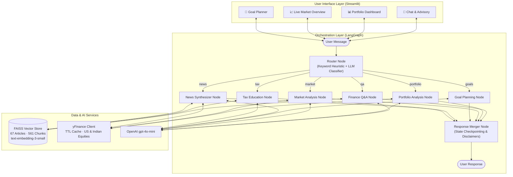

# 💹 AI Finance Assistant
### Democratizing Financial Literacy Through Intelligent Conversational AI
**Applied Agentic AI for SWEs — Capstone Project**

[](https://www.python.org/downloads/)
[](https://langchain-ai.github.io/langgraph/)
[](tests/)
[](htmlcov/)
[](https://github.com/psf/black)
[](https://github.com/astral-sh/ruff)

---

## 📖 Executive Summary

Financial literacy remains one of the greatest barriers preventing millions of everyday individuals from achieving long-term wealth security. Complex terminology, overwhelming investment choices, and fear of costly errors discourage beginners from entering the markets.

The **AI Finance Assistant** solves this challenge by delivering personalized, accessible, and grounded financial education through an intelligent multi-agent conversational system. Built on **LangGraph**, **LangChain**, and **FAISS**, the system coordinates **six specialized AI agents** across financial domains, combining verified educational knowledge with live market data across both **US and Indian financial ecosystems**.

---

## 🏛️ System Architecture



---

## ✨ Key Capabilities

### 1. Dual-Market Ecosystem Support (US & India)
- **United States:** NYSE, NASDAQ, S&P 500, 401(k), Traditional & Roth IRAs, HSAs, IRS capital gains brackets.
- **India:** NSE, BSE, Nifty 50, Sensex, Bank Nifty, Section 80C deductions, ELSS, PPF, NPS, Sovereign Gold Bonds (SGB), and Union Budget 2024 capital gains rules (LTCG 12.5%, STCG 20%).
- **Dual-Currency Formatting:** Seamlessly formats and computes figures in **$ (USD)** and **₹ (INR)** with Indian numbering support (Lakhs and Crores).

### 2. The Six Specialized Agents
1. **Finance Q&A Agent:** Explains investing basics, compound interest, index funds, and personal finance terms grounded in RAG.
2. **Portfolio Analysis Agent:** Reviews user portfolios, calculates total value, cost basis, unrealized P&L, sector weights, and 0–100 diversification scores. Provides constructive rebalancing guidance.
3. **Market Analysis Agent:** Real-time quotes, 52-week ranges, P/E ratios, and market trends across S&P 500, NASDAQ, Nifty 50, and Sensex.
4. **Goal Planning Agent:** Models compound growth, calculates required monthly savings / SIPs, factors in inflation, and recommends asset allocations.
5. **News Synthesizer Agent:** Pulls live company headlines via yFinance, contextualizes them with financial principles, and filters out short-term market noise.
6. **Tax Education Agent:** Explains tax deductions, retirement account types, and capital gains laws across US and Indian frameworks with mandatory disclaimers.

### 3. Retrieval-Augmented Generation (RAG)
- **Curated Knowledge Base:** **67 high-quality financial education articles** categorized across `basics`, `portfolio`, `tax`, `market`, `goals`, and `news`.
- **Vector Search:** Embedded via OpenAI `text-embedding-3-small` into **561 chunks** indexed with **FAISS**.
- **Maximal Marginal Relevance (MMR):** Balances relevance against diversity ($\lambda = 0.5$) with category metadata filtering and source citations.

---

## 📂 Project Directory Structure

```
ai_finance_assistant/
├── config.yaml                     # Central system configuration
├── requirements.txt                # Python dependencies
├── pyproject.toml                  # Linting & coverage settings (ruff, black, pytest)
├── Dockerfile                      # Container build file
├── docker-compose.yml              # Single-command container deployment
├── README.md                       # Main project documentation
├── conftest.py                     # Global pytest fixtures
│
├── docs/
│   ├── TECHNICAL_DESIGN_DOCUMENT.md # Deep-dive architecture and design specs
│   └── DEMO_VIDEO_SCRIPT.md        # Step-by-step 5-10 min video recording script
│
├── sample_data/
│   ├── sample_portfolio.json       # Multi-asset test portfolio (US & India)
│   └── sample_queries.json         # Representative test queries per agent
│
├── src/
│   ├── core/                       # Core infrastructure
│   │   ├── llm_client.py           # Unified LLM factory (OpenAI, Gemini, Claude)
│   │   ├── logging_config.py       # Structlog configuration
│   │   ├── settings.py             # Pydantic settings loading from config.yaml + .env
│   │   └── state.py                # LangGraph AppState, Holding, and AgentOutput definitions
│   │
│   ├── data/
│   │   └── articles/               # 67 curated articles in 6 category directories
│   │       ├── basics/ (11)
│   │       ├── portfolio/ (12)
│   │       ├── tax/ (13)
│   │       ├── market/ (11)
│   │       ├── goals/ (11)
│   │       └── news/ (9)
│   │
│   ├── rag/                        # RAG pipeline
│   │   ├── document_loader.py      # Article loader with category filtering
│   │   ├── chunker.py              # Finance-aware recursive splitter
│   │   ├── embeddings.py           # Embeddings factory (OpenAI text-embedding-3-small)
│   │   ├── vector_store.py         # FAISS vector store manager
│   │   ├── retriever.py            # MMR semantic retriever with source attribution
│   │   ├── rag_chain.py            # Complete RAG chain with disclaimer injection
│   │   └── build_index.py          # CLI index builder utility
│   │
│   ├── agents/                     # Specialized agent implementations
│   │   ├── base_agent.py           # BaseFinanceAgent abstract class with error handling
│   │   ├── qa_agent.py             # Finance Q&A Agent
│   │   ├── portfolio_agent.py      # Portfolio Analysis Agent
│   │   ├── market_agent.py         # Market Analysis Agent
│   │   ├── goal_agent.py           # Goal Planning Agent
│   │   ├── news_agent.py           # News Synthesizer Agent
│   │   └── tax_agent.py            # Tax Education Agent
│   │
│   ├── utils/                      # Shared utilities
│   │   ├── disclaimers.py          # Centralized regulatory disclaimers
│   │   ├── formatters.py           # Dual-currency and numbering formatters
│   │   └── market_data.py          # yFinance client with TTL cache & ticker resolution
│   │
│   ├── workflow/                   # LangGraph orchestration
│   │   ├── router.py               # Hybrid keyword & zero-shot intent router
│   │   └── graph.py                # StateGraph builder, nodes, and checkpointer
│   │
│   └── web_app/                    # Streamlit responsive frontend
│       ├── app.py                  # Main entry point & sidebar controls
│       ├── session.py              # State management & session lifecycle
│       ├── components/
│       │   ├── charts.py           # Plotly charts (Sector Donut, Returns Bar, Compounding Area)
│       │   └── disclaimer_footer.py # Standardized footer disclaimer
│       └── pages/
│           ├── chat.py             # Tab 1: Multi-turn Chat & Advisory
│           ├── portfolio.py        # Tab 2: Live Portfolio Dashboard
│           ├── market.py           # Tab 3: Real-Time Market Overview
│           └── goals.py            # Tab 4: Goal Planner & Simulator
│
└── tests/
    ├── unit/                       # Unit tests (111 tests)
    │   ├── test_settings.py
    │   ├── test_state.py
    │   ├── test_llm_client.py
    │   ├── test_market_data.py
    │   ├── test_formatters.py
    │   ├── test_rag_document_loader.py
    │   ├── test_rag_chunker.py
    │   ├── test_rag_vector_store.py
    │   ├── test_rag_retriever.py
    │   ├── test_rag_chain.py
    │   ├── test_agents.py
    │   ├── test_router.py
    │   ├── test_graph.py
    │   └── test_web_app.py
    └── integration/                # Integration tests (2 tests)
        └── test_workflow_e2e.py
```

---

## 🚀 Quickstart Guide

### 1. Prerequisites
- Python 3.11+
- An OpenAI API Key (or Google Gemini API Key)

### 2. Installation & Setup
```bash
# Clone the repository
git clone <repo-url>
cd ai_finance_assistant

# Create and activate a virtual environment
python3 -m venv venv
source venv/bin/activate  # On Windows: venv\Scripts\activate

# Install dependencies
pip install -r requirements.txt

# Configure environment variables
cp .env.example .env
# Edit .env and paste your OPENAI_API_KEY
```

### 3. Build the Vector Index (One-Time Setup)
```bash
python -m src.rag.build_index --force
```
*Output: Loads 67 articles, creates 561 chunks, and persists the FAISS vector index to `data/faiss_index/`.*

### 4. Launch the Web Application
```bash
streamlit run src/web_app/app.py
```
Open your browser at `http://localhost:8501`.

---

## 🧪 Testing & Code Quality

The project features a **113-test suite** covering unit, agent, integration, and workflow execution.

```bash
# Run full test suite with coverage report
python -m pytest tests/ -v

# Check linting with Ruff
python -m ruff check src tests

# Check code formatting with Black
python -m black --check src tests
```

### Test Coverage Summary: **87% Overall Coverage**
```
Name                               Stmts   Miss  Cover
------------------------------------------------------
src/core/state.py                     31      0   100%
src/utils/formatters.py               29      0   100%
src/utils/disclaimers.py               4      0   100%
src/rag/chunker.py                    25      0   100%
src/rag/rag_chain.py                  62      0   100%
src/web_app/components/charts.py      53      0   100%
src/web_app/session.py                21      0   100%
src/core/settings.py                  77      1    99%
src/workflow/router.py                45      2    96%
src/workflow/graph.py                136     10    93%
src/agents/news_agent.py              50      4    92%
src/agents/portfolio_agent.py         93      8    91%
src/agents/market_agent.py            75      7    91%
src/core/llm_client.py                40      4    90%
src/utils/market_data.py              82      9    89%
src/rag/retriever.py                  65      8    88%
src/agents/goal_agent.py              98     21    79%
src/agents/qa_agent.py                44     10    77%
src/rag/document_loader.py            59     14    76%
src/agents/tax_agent.py               43     11    74%
src/rag/vector_store.py               80     25    69%
------------------------------------------------------
TOTAL                               1288    171    87%
```

---

## 🐳 Docker Deployment

To build and run the application in a standalone Docker container:

```bash
# Using Docker Compose
docker-compose up --build -d

# Or direct Docker build
docker build -t ai-finance-assistant .
docker run -p 8501:8501 --env-file .env ai-finance-assistant
```
The application will be live at `http://localhost:8501`.

---

## ⚖️ Regulatory Compliance & Disclaimer

> ⚠️ **Educational Disclaimer:** The AI Finance Assistant is designed strictly for informational and financial literacy education. It does not provide certified financial, investment, legal, or tax advice. Past market performance is no guarantee of future returns. Users must consult a licensed financial advisor (e.g. SEBI-registered RIA in India or CFP/CPA in the US) prior to making investment decisions.

---

## 📄 License
This project is submitted as part of the **Applied Agentic AI for SWEs** Capstone Program.
Licensed under the [MIT License](LICENSE).
