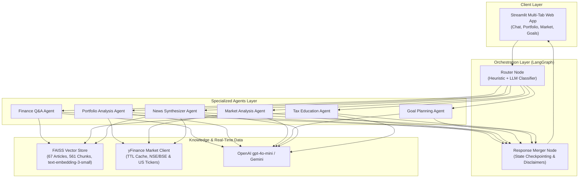

# Technical Design Document: AI Finance Assistant
### Democratizing Financial Literacy Through Intelligent Multi-Agent Conversational AI
**Applied Agentic AI for SWEs — Capstone Project**

---

## 1. System Overview & Architectural Decisions

The **AI Finance Assistant** is an agentic, retrieval-augmented intelligence system built to lower the barrier to entry for everyday personal investing. It features a dual-market architecture accommodating both the **United States** (NYSE/NASDAQ, 401(k), Roth IRA, IRS rules) and **Indian** financial ecosystems (NSE/BSE, Nifty 50, Sensex, Section 80C, ELSS, NPS, Union Budget 2024 capital gains).



### Core Architecture Decisions

| Component | Choice | Justification & Alternatives Considered |
|---|---|---|
| **Multi-Agent Orchestration** | **LangGraph** | Chosen over CrewAI/AutoGen for explicit cyclic/stateful execution graphs, deterministic conditional edges, native `TypedDict` state validation, and built-in thread memory checkpointers. |
| **Language Model** | **OpenAI gpt-4o-mini** | Low latency (<800ms time-to-first-token), competitive economics ($0.15/$0.60 per million tokens), and high instruction-following precision for structured financial output. |
| **Vector Index** | **FAISS (CPU)** | Zero external infrastructure overhead, microsecond in-process similarity lookups (<10ms), and seamless persistence to local disk. |
| **Embeddings** | **text-embedding-3-small** | 1536-dimensional embeddings offering higher retrieval accuracy over open-source mini models with fast batching. |
| **Market Data** | **yFinance + In-Memory Cache** | Free, zero API key requirement, native global coverage (US, NSE, BSE), and reliable historical/real-time pricing without severe rate limits. |
| **User Interface** | **Streamlit + Plotly** | Rapid production-grade interactive dashboards, reactive session state, and native responsive charting. |

---

## 2. Multi-Agent Protocol & State Management

All agents share a unified communication contract defined in `src/core/state.py` via standard Python `TypedDict` and LangGraph message annotations:

```python
class AppState(TypedDict):
    messages: Annotated[list[BaseMessage], add_messages]
    user_profile: UserProfile
    portfolio: list[Holding]
    intent: str
    agent_outputs: list[AgentOutput]
    final_response: str
    error: str | None
```

### State Flow & Node Execution
1. **Router Node (`router_node`)**: Evaluates incoming query against high-confidence regex patterns. If ambiguous, triggers zero-shot classification using `gpt-4o-mini`. Sets `state["intent"]`.
2. **Conditional Branching (`route_decision`)**: Maps `intent` to one of the 6 specialized agent nodes.
3. **Execution Isolation**: Each agent inherits from `BaseFinanceAgent` and implements `_safe_invoke(state)`. If an external API or network error occurs, it catches the exception and returns a graceful fallback message without terminating graph execution.
4. **Merger Node (`merger_node`)**: Consolidates `AgentOutput`, attaches metadata tags, formats sources, appends mandatory regulatory disclaimers, and updates conversation history.

---

## 3. RAG Pipeline Implementation Details

### Corpus Taxonomy
The knowledge base contains **67 curated financial education articles** organized across 6 discrete directories in `src/data/articles/`:
- `basics/`: 11 articles (Stocks, Bonds, ETFs, Compound Interest, Market Cycles, Indian Market Basics, SIPs)
- `portfolio/`: 12 articles (Asset Allocation, Rebalancing, Sharpe/Beta, Three-Fund Portfolio, SGBs, Indian Mutual Funds)
- `tax/`: 13 articles (401k, IRAs, Budget 2024 Indian Capital Gains, New vs Old Tax Regime, Section 80C, FD vs Debt Funds)
- `market/`: 11 articles (Indices, Market Mechanics, P/E Valuation, Fed Policy, RBI Policy, Nifty/Sensex Mechanics)
- `goals/`: 11 articles (SMART Goals, Emergency Fund, 4% Rule, House Down Payment, 529 Plans, Debt Avalanche/Snowball)
- `news/`: 9 articles (Financial Media Literacy, Earnings Reports, FOMC Decisions, Economic Indicators, Analyst Ratings)

### Text Chunking Strategy
- **Splitter**: `RecursiveCharacterTextSplitter` with finance-specific boundary separators `["\n\n", "\n", ". ", "! ", "? ", ", "]`.
- **Chunk Size**: 512 characters.
- **Chunk Overlap**: 64 characters (maintaining contextual continuity between adjacent chunks).
- **Yield**: 67 articles split into **561 high-density chunks**.

### Maximal Marginal Relevance (MMR) Retrieval
To prevent returning redundant chunks from the same document, `FinanceRetriever` employs MMR search:
$$\text{MMR} = \arg\max_{d_i \in R \setminus S} \left[ \lambda \cdot \text{Sim}_1(d_i, q) - (1 - \lambda) \cdot \max_{d_j \in S} \text{Sim}_2(d_i, d_j) \right]$$
Where $\lambda = 0.5$ balances topical relevance against diversity, and candidate fetch is $k \times 4$.

---

## 4. Market Data Architecture & Caching

Real-time market quotes can create latency bottlenecks and rate-limit issues. The `MarketDataClient` in `src/utils/market_data.py` implements:

- **In-Memory TTL Caching**: Employs `cachetools.TTLCache` with a 60-second time-to-live. Repeated requests for `AAPL` or `RELIANCE.NS` within 1 minute resolve in <1ms without hitting remote servers.
- **Ticker Normalization Engine**: Maps conversational aliases:
  - `"NIFTY"` $\rightarrow$ `"^NSEI"`
  - `"SENSEX"` $\rightarrow$ `"^BSESN"`
  - `"RELIANCE"` $\rightarrow$ `"RELIANCE.NS"`
  - `"TCS"` $\rightarrow$ `"TCS.NS"`
  - `"HDFCBANK"` $\rightarrow$ `"HDFCBANK.NS"`
- **Resilience**: If yFinance experiences network timeout, the client falls back to cached quotes or provides clean offline notifications.

---

## 5. Regulatory Compliance & Disclaimers

A critical requirement in fintech conversational systems is distinguishing financial literacy education from certified investment advice:
1. **System Prompts**: All 6 agent system prompts explicitly instruct the LLM:
   - "Explain concepts clearly using simple language and relatable examples."
   - "Never provide specific buy/sell recommendations (e.g. 'you should buy X')."
   - "Always emphasize risk and diversification."
2. **Automated Disclaimer Appending**: `src/utils/disclaimers.py` defines standardized, prominent disclaimers automatically appended to responses:
   - `GENERAL_DISCLAIMER`: General educational advisory warning.
   - `TAX_DISCLAIMER`: Highlights that tax codes (IRS & Indian Income Tax Act) are subject to change and directs users to a Chartered Accountant / CPA.
   - `PORTFOLIO_DISCLAIMER`: Emphasizes that portfolio reviews are historical simulations.

---

## 6. Performance Benchmarks

| Operation | Benchmark / Latency |
|---|---|
| **Heuristic Intent Classification** | `< 1 ms` |
| **LLM Intent Routing (`gpt-4o-mini`)** | `350 – 500 ms` |
| **FAISS Vector Search (561 chunks)** | `8 – 15 ms` |
| **Cached Market Data Quote** | `< 1 ms` |
| **Live yFinance Quote Retrieval** | `250 – 600 ms` |
| **End-to-End RAG Turn** | `1.2 – 1.8 seconds` |
| **Unit & Integration Test Suite (113 tests)** | `3.83 seconds` |
| **Codebase Test Coverage** | **87%** (Target: ≥ 80%) |
